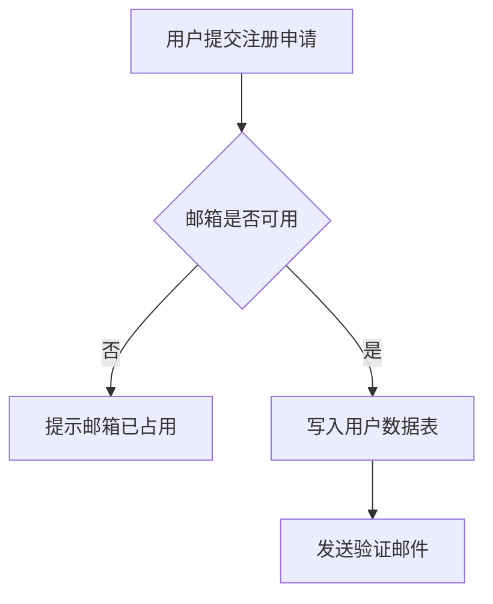

# 绘制图表（diagramming）

## 目的

绘制系统中的 ER 图、流程图等各类图形，供文档引用。

## 执行者

全部角色（通用技能）

## 约束

**一律使用 Mermaid**。禁止使用图片、ASCII 图或外部绘图工具作为交付物图形。

## 常用图类型与用途

| 图类型 | Mermaid 关键字 | 用途 |
|--------|---------------|------|
| 流程图 | `flowchart TD` | 业务流程、业务处理逻辑 |
| 泳道/子图 | `flowchart` + `subgraph` | 跨角色业务流程 |
| 时序图 | `sequenceDiagram` | 组件交互、接口调用链 |
| ER 图 | `erDiagram` | 数据模型 |
| 状态图 | `stateDiagram-v2` | 实体状态机 |
| 类图 | `classDiagram` | 模块/类结构 |
| 甘特图 | `gantt` | 项目里程碑、进度 |
| 饼图 | `pie` | 占比统计（如缺陷分布） |

## 规范

1. 每张图有**标题**（文档中用小节标题）与**图注**（说明图表达什么）。
2. 节点命名用业务语言，不用内部代号。
3. 图与正文一致：正文所述流程/实体/状态必须能在图中找到。
4. 大图拆分：单图超过约 20 个节点时拆分为多张。
5. 语法必须可渲染（提交前自检）。

## 示例

## 检查清单

- [ ] 全部图形为 Mermaid
- [ ] 每张图有标题与图注
- [ ] 语法可渲染
- [ ] 图与正文一致

## 触发与边界

**该用**：任何需要"图示"的场景。

**不该用**：装点性插图（无信息量的图 = 噪音）；可用表格表达的简单罗列。

## 常见错误

- 用 ASCII 图或外部图片代替 Mermaid（违规）。
- 单图节点过多（>20）不拆分，可读性差。
- 图与正文描述不一致（图是摆设）。
- 节点用 `step1/helper2` 之类无语义命名。
