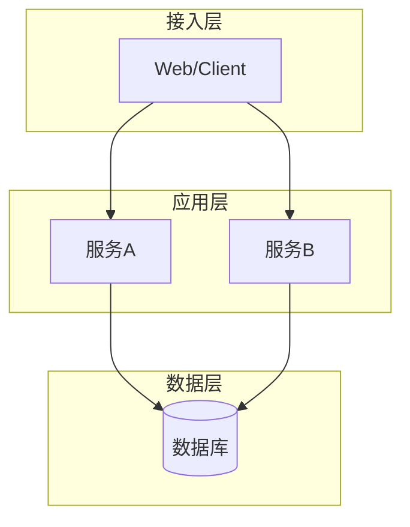
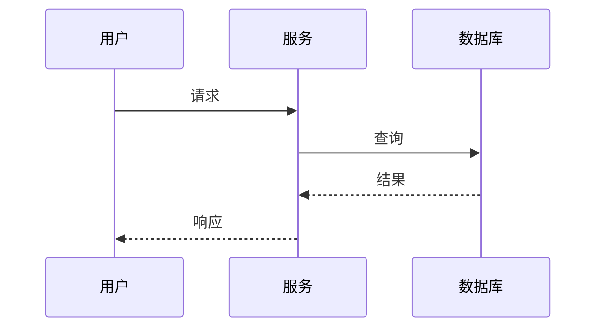
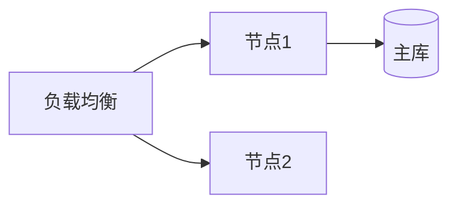

# 架构设计：$PROJECT_NAME

> 产出角色：architect ｜ 存放：design/ARCH.md

## 1. 技术栈选型

| 类别 | 选型 | 版本 | 理由 | 备选与被否决原因 |
|------|------|------|------|-----------------|
| 语言 | | | | |
| 框架 | | | | |
| 存储 | | | | |
| 依赖库 | | | | |

## 2. 系统架构

（图注：说明分层与职责）

## 3. 组件设计

| 组件 | 职责 | 输入 | 输出 | 依赖 |
|------|------|------|------|------|
| | | | | |

## 4. 关键交互时序

## 5. 部署视图

## 6. 非功能支撑

| 需求编号 | 架构措施 |
|---------|---------|
| NF-P-xxx | 缓存 / 异步 / 索引 |
| NF-S-xxx | 认证网关 / 加密 / 审计 |

## 7. 设计决策记录（ADR）

| 编号 | 决策 | 背景 | 结论 | 影响 |
|------|------|------|------|------|
| ADR-001 | | | | |

## 8. 可追溯性

| 模块 | 关联功能编号 | 架构组件 |
|------|-------------|---------|
| $MOD | fr-$MOD-xxx | |
