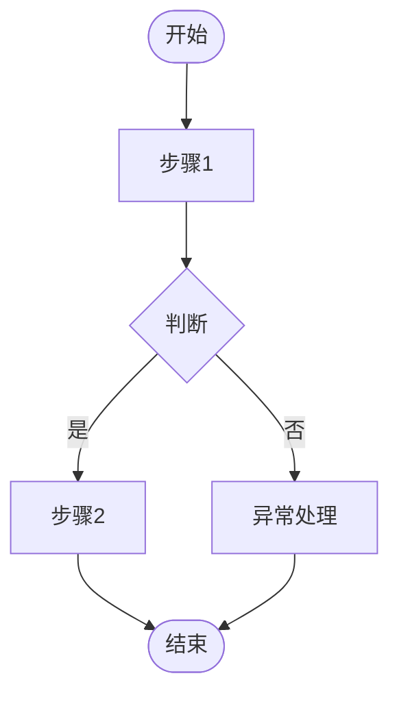
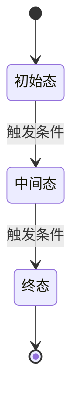

# 业务分析说明书：$MOD

> 模版：BIZ-MOD.md ｜ 产出角色：product-manager ｜ 存放：docs/requirements/biz-$MOD.md

## 1. 模块说明

（模块职责、边界、与其它模块的关系）

## 2. 业务清单

| 业务编号 | 业务名称 | 涉及角色 |
|---------|---------|---------|
| biz-xxx | | |

---

## 3. 业务详述

> 每项业务复制以下小节。

### biz-xxx （业务名称）

| 项 | 内容 |
|----|------|
| 业务说明 | |
| 前置条件 | |
| 涉及角色 | |
| 业务处理 | |
| 业务输出 | |

**业务流程**

---

## 4. 业务实体

> 每个实体一节。

### 实体：（实体名）

| 属性 | 类型 | 约束 | 说明 |
|------|------|------|------|
| | | | |

**状态机**

**非法迁移**（禁止的状态变化）：列出。

---

## 5. 业务-模块归属

| 业务编号 | 所属模块 |
|---------|---------|
| biz-xxx | $MOD |
