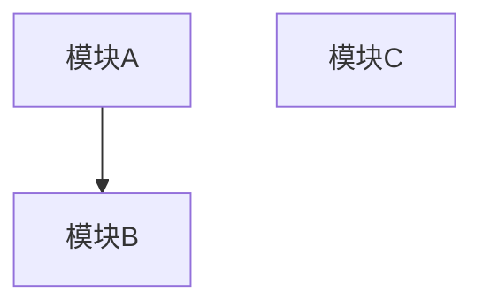
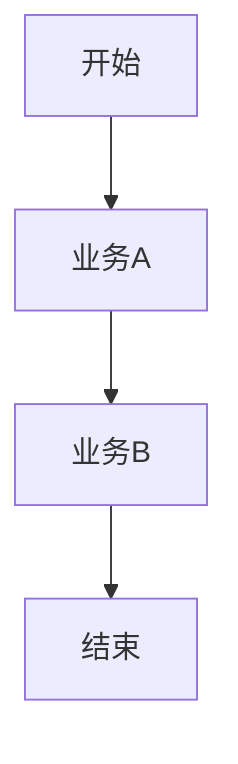

# 业务分析概览：$PROJECT_NAME

> 模版：BIZ-OVERVIEW.md ｜ 产出角色：product-manager ｜ 存放：docs/requirements/overview.md

## 1. 系统定位

（系统解决什么问题，服务谁，一句话定位）

## 2. 使用用户与角色

| 角色 | 说明 | 主要权限 |
|------|------|---------|
| | | |

## 3. 项目边界

### 3.1 系统负责
- 

### 3.2 系统不负责
- 

## 4. 高层模块划分

| 模块 | 名称 | 职责 | 依赖模块 |
|------|------|------|---------|
| $MOD | | | |

### 4.1 模块依赖图

## 5. 业务清单

| 业务编号 | 业务名称 | 所属模块 | 涉及角色 |
|---------|---------|---------|---------|
| biz-001 | | | |

## 6. 业务全景流程

## 7. 模块划分原则说明

（说明为什么这样划分：高内聚、低耦合的体现）
