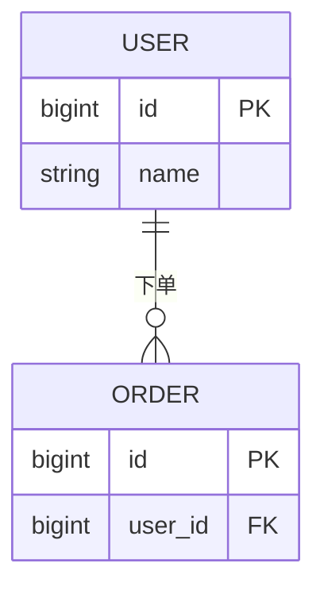

# 数据库设计：$PROJECT_NAME

> 产出角色：architect ｜ 存放：design/DATABASE.md

## 1. 数据模型概览

（说明设计原则、范式取舍）

## 2. E-R 图



## 3. 表清单

| 表名 | 说明 | 对应实体 | 关联功能编号 |
|------|------|---------|-------------|
| | | | |

## 4. 表结构详述

### 表：表名

| 字段 | 类型 | 允许空 | 默认值 | 约束 | 说明 |
|------|------|--------|--------|------|------|
| | | | | | |

**索引**

| 索引名 | 类型 | 字段 | 支撑的查询/功能编号 |
|--------|------|------|-------------------|
| | | | |

## 5. DDL

```sql
-- 表：表名
CREATE TABLE `xxx` (
  `id` BIGINT NOT NULL AUTO_INCREMENT COMMENT '主键',
  PRIMARY KEY (`id`)
) ENGINE=InnoDB DEFAULT CHARSET=utf8mb4 COMMENT='表说明';
```

## 6. 数据生命周期

（归档、分区、清理策略）

## 7. 安全

| 敏感字段 | 处理方式 |
|---------|---------|
| | |
