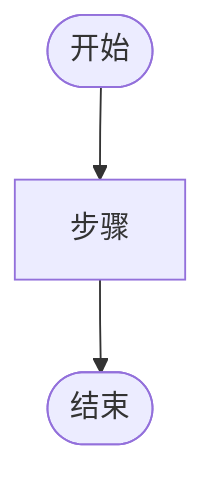

# 数据结构与算法设计：$PROJECT_NAME

> 产出角色：architect ｜ 存放：design/DATASTRUCT-ALGORITHM.md
> 面向"重要、复杂"的功能。

## 编号：DSA-xxx （功能名称）

| 项 | 内容 |
|----|------|
| 关联功能编号 | fr-$MOD-xxx |
| 问题描述 | |
| 约束 | |

### 数据结构选型

| 结构 | 选型 | 理由 | 空间复杂度 |
|------|------|------|-----------|
| | | | |

### 算法描述

（步骤或伪代码）

```
function foo(input):
    ...
    return output
```

### 复杂度分析

| 指标 | 值 | 说明 |
|------|----|------|
| 时间复杂度 | | |
| 空间复杂度 | | |

### 边界条件

- 

### 流程图



---
