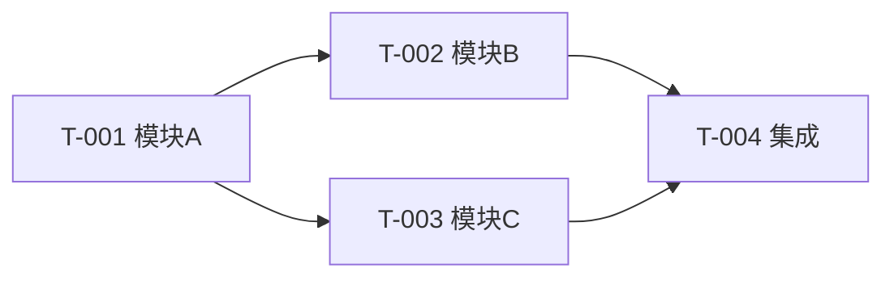

# 开发任务分解：$PROJECT_NAME

> 模版：DEV-TASKS.md ｜ 产出角色：architect ｜ 存放：design/DEV-TASKS.md
> **性质：规划物**。本文件只描述"拆成哪些任务、依赖关系、建议由哪类角色承担"，**不含执行派发**（谁在何时把任务真正下发，属独立环节）。

## 1. 说明

- 本文档在**设计评审通过、设计修订完成之后**产出。
- 分解粒度：**以模块为单位**，每个任务可独立开发与验收。
- 本文件是开发阶段的输入依据。

## 2. 任务清单

| 任务编号 | 所属模块 | 覆盖功能编号 | 前置依赖 | 建议责任角色 | 并行组 | 验收标准 |
|---------|---------|-------------|---------|-------------|-------|---------|
| T-001 | $MOD | fr-$MOD-001, fr-$MOD-002 | — | backend-developer | G1 | |
| T-002 | $MOD2 | fr-$MOD2-001 | T-001 | ui-developer | G2 | |

> 字段说明：
> - **前置依赖**：必须先完成的任务编号；无则填 `—`。
> - **建议责任角色**：由任务性质推导（后端逻辑 → backend-developer；界面交互 → ui-developer）。**这是技术建议，非最终指派**。
> - **并行组**：由依赖拓扑推导，**同组任务无相互依赖，可并行**。
> - 本表**不含**优先级与排期（属项目管理环节）。

## 3. 依赖拓扑

## 4. 并行组划分

| 并行组 | 任务 | 说明 |
|-------|------|------|
| G1 | T-001 | 无依赖，可立即开始 |
| G2 | T-002, T-003 | 依赖 T-001 完成，彼此独立可并行 |
| G3 | T-004 | 依赖 G2 全部完成 |

> 划分依据：同一并行组内任务之间**无依赖**；跨组按拓扑顺序推进。

## 5. 覆盖性校验

| 检查项 | 结果 |
|--------|------|
| 所有模块是否都有任务 | |
| 所有功能编号 `fr-$MOD-xxx` 是否被覆盖 | |
| 是否存在依赖环 | |
| 每个任务是否可独立验收 | |

## 6. 待确认项

| 编号 | 待确认内容 | 影响 | 状态 |
|------|-----------|------|------|
| Q-01 | | | |
