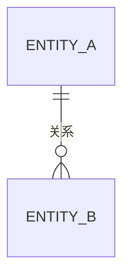

# 数据字典：$PROJECT_NAME

> 模版：DICT.md ｜ 产出角色：product-manager ｜ 存放：docs/requirements/dict.md

## 1. 说明

本文档定义系统中的业务实体及其字段，是数据库设计的依据。

## 2. 实体清单

| 实体编号 | 实体名 | 说明 | 所属模块 |
|---------|--------|------|---------|
| E-001 | | | |

## 3. 实体详述

### E-001 （实体名）

| 字段 | 类型 | 必填 | 约束 | 说明 |
|------|------|------|------|------|
| | | | | |

**状态枚举**

| 状态值 | 含义 | 可迁移至 |
|--------|------|---------|
| | | |

**状态机**

---

## 4. 实体关系

## 5. 全局枚举与码表

| 码表 | 编码 | 含义 |
|------|------|------|
| | | |

## 6. 敏感字段清单

| 实体 | 字段 | 敏感级别 | 处理要求（加密/脱敏/不落盘） |
|------|------|---------|---------------------------|
| | | | |
