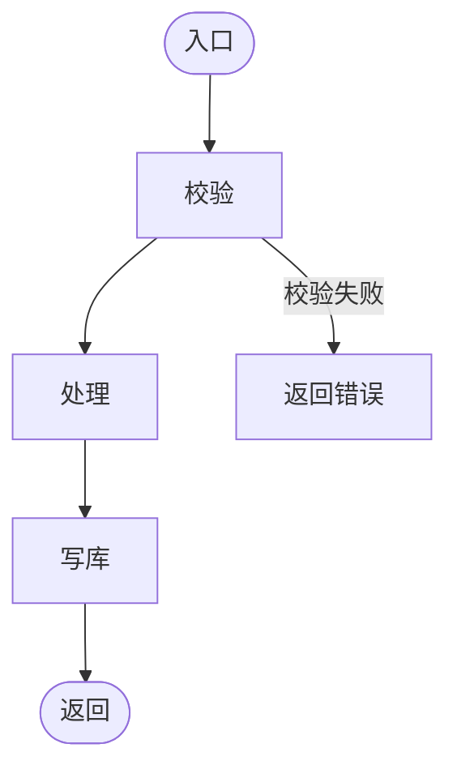

# 功能设计：$PROJECT_NAME

> 产出角色：architect ｜ 存放：design/FUNC.md

## 1. 说明

以模块为单位组织，每个设计条目必须关联功能编号 `fr-$MOD-xxx`。

---

## 2. 模块：$MOD

### 2.1 fr-$MOD-xxx （功能名称）

| 项 | 内容 |
|----|------|
| 对应功能编号 | fr-$MOD-xxx |
| 所属模块 | $MOD |
| 功能说明 | |
| 依赖 | |
| 处理流程 | 见下方流程 |
| 异常路径 | |

---

## 3. 模块交互

