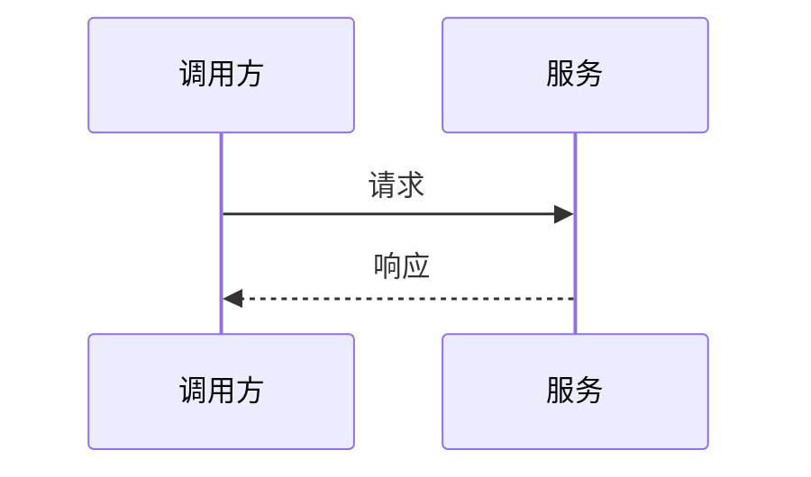

# 接口设计：$PROJECT_NAME

> 产出角色：architect ｜ 存放：design/INTERFACE.md

## 1. 对内接口（模块间）

### IF-INT-xxx （接口名）

| 项 | 内容 |
|----|------|
| 提供方模块 | |
| 调用方模块 | |
| 关联功能编号 | fr-$MOD-xxx |
| 签名 | `func(arg1, arg2) -> ret` |
| 参数 | | 
| 返回 | |
| 异常 | |
| 说明 | |

---

## 2. 对外接口

### IF-EXT-xxx （接口名）

| 项 | 内容 |
|----|------|
| 协议 | REST / RPC / MQ |
| 方法与路径 | `POST /api/v1/xxx` |
| 关联功能编号 | fr-$MOD-xxx |
| 认证 | |
| 幂等 | |

**请求**

| 字段 | 类型 | 必填 | 说明 |
|------|------|------|------|
| | | | |

**响应**

| 字段 | 类型 | 说明 |
|------|------|------|
| | | |

**错误码**

| 码 | 含义 | 处理建议 |
|----|------|---------|
| 400 | 参数错误 | |

---

## 3. 接口时序

## 4. 接口与功能映射

| 接口 | 关联功能编号 |
|------|-------------|
| | |
