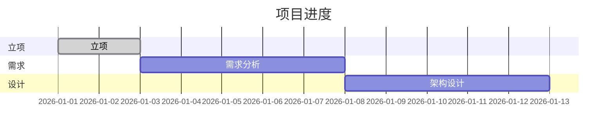

# 进度看板：$PROJECT_NAME

> 产出角色：project-manager ｜ 存放：board/KANBAN.md
> 更新人：每次状态变化后由 project-manager 更新

## 1. 当前阶段

**阶段**：立项 / 需求 / 设计 / 编码 / 测试 / 验收 / 发布

## 2. 任务看板

| 任务ID | 阶段 | 模块 | 责任角色 | 输入 | 输出 | 状态 | 评审状态 | 备注 |
|--------|------|------|---------|------|------|------|---------|------|
| T-001 | 立项 | - | project-manager | 用户构思 | docs/PROJ_xxx.md | 待办 | 待评审 | |

> 状态：待办 / 进行中 / 待评审 / 已通过 / 打回

## 3. 阶段门禁状态

| 阶段 | 门禁 | 评审结论 | 日期 | 状态 |
|------|------|---------|------|------|
| 立项 | 立项评审 | | | |
| 需求 | 需求评审 | | | |
| 设计 | 设计评审 | | | |
| 编码 | 代码评审 | | | |
| 测试 | 测试评估 | | | |
| 交付 | 项目验收 | | | |

## 4. 里程碑进度

## 5. 缺陷/风险摘要

| 编号 | 类型 | 描述 | 级别 | 责任角色 | 状态 |
|------|------|------|------|---------|------|
| | | | | | |

---

最后更新：YYYY-MM-DD HH:mm
