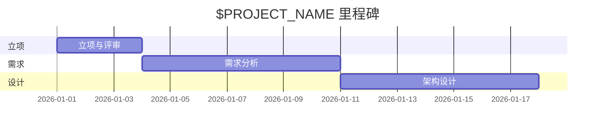

# 立项报告：$PROJECT_NAME

> 模版：PROJECT.md ｜ 产出角色：project-manager ｜ 存放：docs/PROJ_$PROJECT_NAME.md

## 1. 项目概述

| 项 | 内容 |
|----|------|
| 项目名称 | $PROJECT_NAME |
| 一句话定位 | （解决什么问题，一句话说清） |
| 版本 | v0.1 |
| 日期 | YYYY-MM-DD |

## 2. 项目背景与目标

- **背景**：（为什么做这个项目）
- **目标**：（可衡量的目标，含成功标准）

## 3. 目标用户与角色

| 角色 | 说明 | 核心诉求 |
|------|------|---------|
| | | |

## 4. 项目范围

### 4.1 范围内（做）
- 

### 4.2 范围外（明确不做）
- 

## 5. 核心业务

| 编号 | 业务名称 | 简述 |
|------|---------|------|
| biz-xxx | | |

## 6. 技术栈与依赖

| 类别 | 选型 | 理由 |
|------|------|------|
| 语言/框架 | | |
| 存储 | | |
| 依赖库 | | |

## 7. 项目约束

| 类别 | 约束 |
|------|------|
| 用户规模 | |
| 性能要求 | |
| 安全要求 | |
| 合规要求 | |
| 交付形态 | |
| 周期/里程碑 | |

## 8. 里程碑

## 9. 风险

| 编号 | 风险 | 影响 | 概率 | 应对 |
|------|------|------|------|------|
| R-01 | | | | |

## 10. 待确认项

| 编号 | 待确认内容 | 影响 | 状态 |
|------|-----------|------|------|
| Q-01 | | | 待用户确认 |

---

## 评审记录

| 评审人 | 结论 | 日期 | 备注 |
|--------|------|------|------|
| 用户 | | | |
| project-reviewer | | | |
