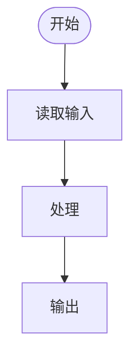

# 软件规格说明书：$MOD

> 模版：SPEC-MOD.md ｜ 产出角色：product-manager ｜ 存放：docs/requirements/spec-$MOD.md

## 1. 模块概述

（模块职责、包含的业务、边界）

## 2. 业务-功能追溯矩阵

| 业务编号 | 业务名称 | 覆盖功能点 | 实现说明 |
|---------|---------|-----------|---------|
| biz-xxx | | fr-$MOD-001, ... | 由哪些功能、如何实现 |

## 3. 功能点详述

> 每个功能点复制以下小节。功能点必须可独立验收。

### fr-$MOD-xxx （功能名称）

| 项 | 内容 |
|----|------|
| 操作的用户 | |
| 输入 | |
| 输出 | |
| 处理逻辑 | （重点：如何操作业务实体，如"插入用户数据表"） |
| 约束条件 | |
| **验证标准** | （可判定的验收条件） |
| 关联业务 | biz-xxx |

**功能流程图**（复杂功能必填）

---

## 4. 界面要求（如涉及）

| 界面 | 说明 | 关联功能点 |
|------|------|-----------|
| | | |

## 5. 数据要求

（该模块涉及的业务实体，详见 dict.md）

| 实体 | 操作（增/删/改/查） | 关联功能点 |
|------|-------------------|-----------|
| | | |

## 6. 模块内约束

- 
