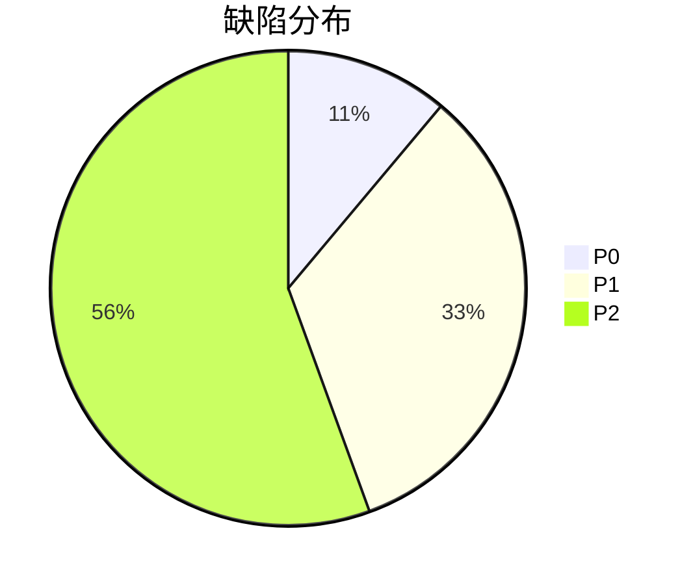

# 测试报告

> 模版：TEST-REPORT.md ｜ 产出角色：test-engineer / test-manager ｜ 存放：test/report/RPT-xxx.md

## 1. 概述

| 项 | 内容 |
|----|------|
| 报告编号 | RPT-xxx |
| 测试版本 | |
| 测试环境 | |
| 测试周期 | |
| 执行人 | |

## 2. 执行统计

| 项 | 数量 |
|----|------|
| 用例总数 | |
| 通过 | |
| 失败 | |
| 阻塞 | |
| 通过率 | |

## 3. 覆盖率

| 功能点数 | 已覆盖 | 覆盖率 |
|---------|--------|--------|
| | | |

（未覆盖项列表）

## 4. 缺陷统计

| 级别 | 新增 | 已修复 | 遗留 |
|------|------|-------|------|
| P0 | | | |
| P1 | | | |
| P2 | | | |

## 5. 非功能测试结果

| 指标 | 目标 | 实测 | 结论 |
|------|------|------|------|
| | | | |

## 6. 遗留问题与风险

| 编号 | 描述 | 影响 | 建议 |
|------|------|------|------|
| | | | |

## 7. 测试结论

- **结论**：通过 / 不通过
- **依据**：P0/P1 遗留情况 + 覆盖率
- **建议**：
